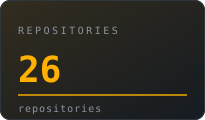
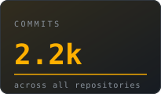
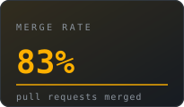
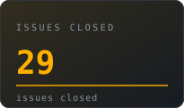
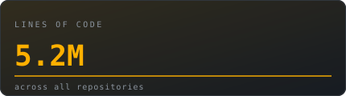
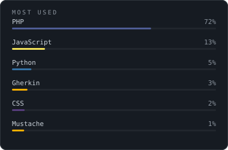

<table>
<tr>
<td width="34%" align="center">

</td>
<td width="66%">

## I build software that people can understand.

Open source is not a licensing model to me. It is a way of keeping software
**inspectable, modifiable and owned by the people who run it**.

> Software should serve its users — not mine them.

`Systems`&nbsp;&nbsp;`Linux`&nbsp;&nbsp;`Open Source`&nbsp;&nbsp;`AI`

</td>
</tr>
</table>

──────&nbsp;&nbsp;**ENGINEERING / OPEN SOURCE / BUILDING**&nbsp;&nbsp;──────

 

  
  
  
  

  

 

<table>
<tr>
<td width="50%" valign="top">

### Most used

</td>
<td width="50%" valign="top">

### Stack

**SYSTEMS** 
Linux · Networking · Distributed Systems

**INFRASTRUCTURE** 
Docker · CI/CD · Self-hosting · Cloud

**LANGUAGES** 
Python · PHP · JavaScript · Shell

**AI** 
Text-to-Speech · LLMs · Speech · Indic languages

</td>
</tr>
</table>

 

---

 

## Things I'm building

### [MisoTTS 8B](https://github.com/MisoLabsAI/MisoTTS)
Speech should be open. A state-of-the-art open text-to-speech model — from research
to a runnable product, shipped to the public instead of behind an API paywall.
`Python` · `PyTorch` · `Transformers`

---

### [agent-skills](https://gitlab.com/vamanakhil/agent-skills)
One source of truth for reusable agent skills that install globally into both
opencode and Claude Code. Every skill follows the open spec and is validated in CI.
`SKILL.md` · `YAML` · `CI`

---

### [cyber-crime forensics lab](https://github.com/Vamanakhil/call-center-scam)
A production-grade digital-forensics training lab for Indian cyber cells: raid a
simulated boiler-room, seize devices, capture RAM and disk images, and rebuild the
fraud operation from cross-system evidence. India-specific law throughout.
`Linux` · `Bash` · `MySQL` · `Forensics`

---

### [medsales-rep](https://code.swecha.org/Vamanakhil/medsales-rep)
Meeting-slot booking and attendance check-in for medical representatives across
8 hospitals — built with a FOSS team under Swecha.
`Node.js` · `React`
