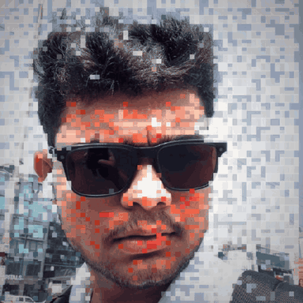

<table>
<tr>
<td width="34%" align="center">

</td>
<td width="66%">

## I build software that people can understand.

Open source is not a licensing model to me. It is a way of keeping software
**inspectable, modifiable and owned by the people who run it**.

> Software should serve its users — not mine them.

`Systems`&nbsp;&nbsp;`Linux`&nbsp;&nbsp;`Open Source`&nbsp;&nbsp;`AI`

</td>
</tr>
</table>

## Now

- **[agent-skills](https://github.com/Vamanakhil/agent-skills)** — portable agent skills for opencode & Claude Code, including a Moodle plugin security auditor.
- **[worklie](https://github.com/Vamanakhil/worklie)** — local-first CLI that turns terminal history and git logs into standup reports.
- **[kinetiq](https://github.com/Vamanakhil/kinetiq)** — AI-native technical media engine: one idea in, branded technical short out.

## Open source

I build in the open with [Swecha](https://swecha.org), part of the Free Software Movement of India. If it isn't inspectable, it isn't finished.

## Reach me

[LinkedIn](https://www.linkedin.com/in/vaman-akhil-b47604243) — always happy to talk FOSS, Moodle, and systems work.
